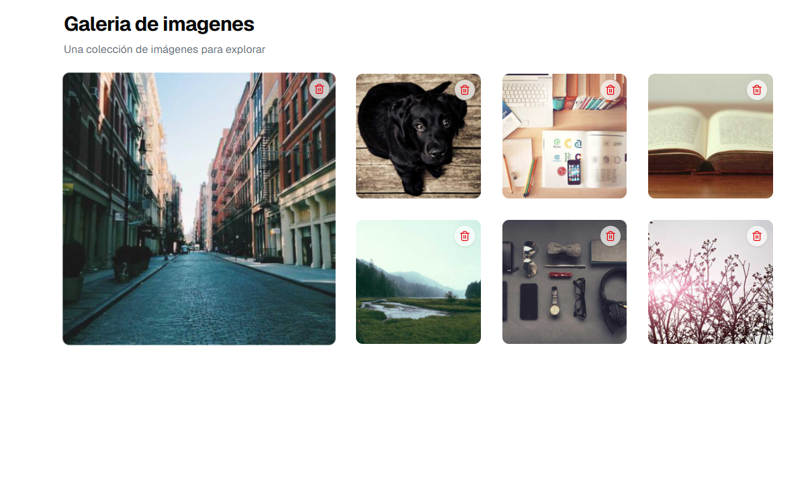
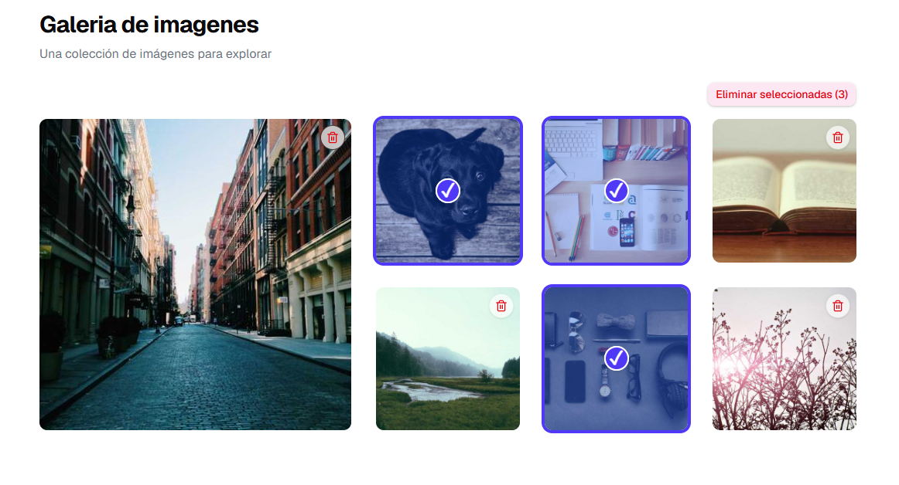
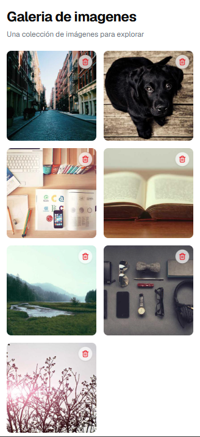

# Image Gallery

Interactive, responsive image gallery built with **React + TypeScript**: featured image, single and bulk deletion, multiple selection and drag-and-drop reordering.

## Technologies

React · TypeScript · Vite · Tailwind CSS · shadcn/ui · Lucide · Sonner · Vitest + React Testing Library

## Features

- Responsive grid: 5 columns on desktop, 4 on tablet and 2 on mobile.
- The first image is the featured one (spans 2x2 cells on desktop).
- Single deletion (trash button) and bulk deletion (multiple selection), always with confirmation.
- Reordering with drag and drop (HTML5 Drag and Drop API).
- Accessible: descriptive `alt` text, `aria-label` on controls, keyboard-operable selection checkbox and visible focus.

## Installation

Requires Node.js 18 or higher.

```bash
git clone https://github.com/ypmodev/Image-Gallery.git
cd Image-Gallery/image-gallery
npm install
npm run dev
```

| Command                 | Description         |
| ----------------------- | ------------------- |
| `npm run dev`           | Development server  |
| `npm run build`         | Production build    |
| `npm run preview`       | Preview the build   |
| `npm test`              | Run the tests       |
| `npm run test:coverage` | Tests with coverage |

## Project Structure

```
image-gallery/
├── docs/                           # README screenshots
│   ├── screenshot.png
│   ├── screenshot-selection.png
│   └── screenshot-mobile.png
├── src/
│   ├── components/
│   │   ├── ui/
│   │   │   ├── button.tsx          # shadcn/ui component
│   │   │   └── sonner.tsx          # Toasts (shadcn/ui + Sonner)
│   │   ├── Gallery.tsx             # Image list and actions
│   │   ├── ImageItem.tsx           # Single image card
│   │   └── ImageItem.test.tsx      # ImageItem tests
│   ├── data/
│   │   └── imagesData.ts           # Sample data (picsum.photos)
│   ├── hooks/
│   │   ├── useImageDragAndDrop.ts  # Drag state
│   │   ├── useImageManagement.ts   # Delete and reorder images
│   │   └── useImageSelection.ts    # Multiple selection
│   ├── lib/
│   │   └── utils.ts                # cn utility
│   ├── types/
│   │   └── image.ts                # ImageType type
│   ├── App.tsx
│   ├── index.css
│   ├── main.tsx
│   └── setupTests.ts
├── .gitignore
├── components.json
├── eslint.config.js
├── index.html
├── package.json
├── package-lock.json
├── tsconfig.json
├── tsconfig.app.json
├── tsconfig.node.json
└── vite.config.ts
```

## Quality

Lighthouse in production: Performance 98 on desktop and 91 on mobile. Accessibility 100, Best Practices 100 and SEO 92 on both.

## Future Implementations

- Migrate drag and drop to dnd-kit (touch and keyboard support).

## Demo

<p align="center">
  
  
</p>

<p align="center">
  
</p>

## Author

**Yanet Pérez** · [GitHub](https://github.com/ypmodev)
